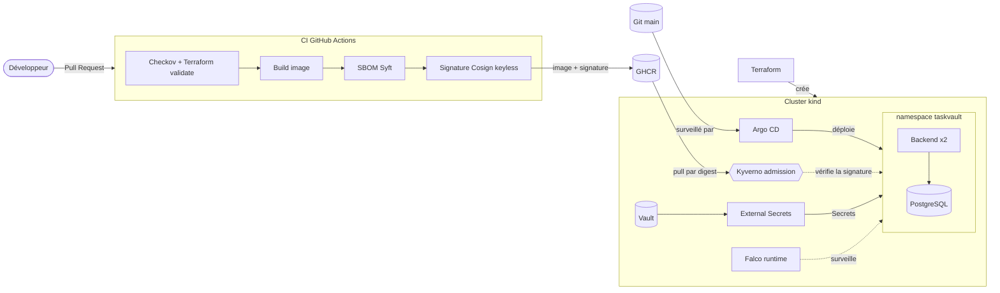

# taskvault-platform


Plateforme de déploiement sécurisé pour [TaskVault](https://github.com/Wavitoo/TaskVault).

TaskVault prouve que le **code** est sécurisé avant fusion (SAST, SCA, secrets, conteneur, DAST).
Ce dépôt prouve que le **déploiement et l'exécution** le sont aussi : Kubernetes durci, chaîne
d'approvisionnement signée, secrets gérés, déploiement GitOps et détection à l'exécution.

> En construction. Tout tourne en local et gratuitement (cluster [kind](https://kind.sigs.k8s.io/)).

## Documentation

- [Modèle de menaces (STRIDE)](docs/threat-model.md) : 19 menaces, contrôle, preuve et statut honnête
- [Journal d'incidents](docs/incidents.md) : ce qui a cassé, pourquoi, et ce qui reste inexpliqué
- [Exceptions Checkov](docs/checkov-exceptions.md) : chaque exception est justifiée
- [Politique de sécurité](SECURITY.md)

## Architecture



Trait plein : flux de déploiement. Pointillé : contrôles (admission et exécution).

## Stack (100 % gratuite)

| Besoin | Outil |
|---|---|
| Cluster local | kind |
| Infrastructure as Code | Terraform (+ scan Checkov) |
| Politiques d'admission | Kyverno |
| Signature d'images, SBOM | Cosign, Syft |
| Secrets | HashiCorp Vault (mode dev) / External Secrets |
| GitOps | Argo CD |
| Détection à l'exécution | Falco |
| Registre d'images | GitHub Container Registry |

## Feuille de route

- [x] 1. Cluster local reproductible
- [x] 2. Déploiement durci de TaskVault (NetworkPolicy, Pod Security, RBAC)
- [x] 3. CI : build, SBOM, signature de l'image, scan IaC
- [x] 4. Kyverno : refus des images non signées
- [x] 5. Gestion des secrets
- [x] 6. GitOps avec Argo CD
- [x] 7. Détection à l'exécution avec Falco
- [x] 8. Terraform pour piloter le tout

## Chaîne d'approvisionnement (CI)

À chaque PR : scan **Checkov** des manifestes (bloquant) et build de l'image. À chaque merge sur `main` :
build de l'image TaskVault (commit épinglé dans `taskvault.ref`), push sur GHCR, **SBOM** (Syft, SPDX),
**signature Cosign sans clé** (identité = ce workflow, via OIDC GitHub) sur le *digest*, puis
vérification de la signature dans le pipeline lui-même. Les exceptions Checkov sont justifiées
dans [docs/checkov-exceptions.md](docs/checkov-exceptions.md). Toutes les actions sont épinglées par SHA.

## Admission : seules les images signées entrent

Une politique Kyverno (`k8s/policies/verify-images.yaml`) refuse tout pod du namespace `taskvault` dont
l'image GHCR n'est pas signée par le workflow `ci.yml` de ce dépôt sur `main`. Vérifié par des tests :
l'image du backend signée par la CI est admise, une image GHCR signée par un autre signataire est refusée
avec le motif « identité non reconnue ».

**Limites connues** : la politique ne couvre que les images de `ghcr.io/*` (l'image Postgres de Docker Hub est
seulement épinglée par digest) ; une liste blanche de registres serait l'étape suivante. Avec `failurePolicy: Fail`,
une panne de Kyverno bloque les créations de pods dans `taskvault` (choix sécurité > disponibilité, limité à ce namespace).

## Secrets : Vault + External Secrets

Plus aucun secret dans git ni créé à la main. Les valeurs sont générées aléatoirement dans **Vault**
(`scripts/configure-vault.sh`), et **External Secrets Operator** les copie dans des Secrets Kubernetes.
ESO s'authentifie auprès de Vault avec le jeton de son ServiceAccount (aucun token statique) et sa politique
est en **lecture seule sur `secret/taskvault/*`** uniquement. Seules des *références* (`ExternalSecret`) sont versionnées.
Postgres lit ses identifiants depuis des fichiers montés, pas depuis des variables d'environnement.

**Limites connues** : Vault tourne en **mode dev** (en mémoire, token root connu, aucune persistance) : c'est
une démonstration locale, pas une configuration de production (il faudrait stockage Raft, unseal automatique, TLS).
Le backend lit ses secrets en variables d'environnement (on ne modifie pas TaskVault), donc un changement dans Vault
n'atteint les pods qu'au redémarrage.

## GitOps : Git est la source de vérité

**Argo CD** déploie le cluster depuis ce dépôt (`main`). On n'exécute plus `kubectl apply` : on fait une PR.
Une seule ressource est appliquée à la main (l'application racine) ; elle déploie le reste
(*app of apps*), dans un ordre imposé par des *sync-waves* : namespace, puis politiques Kyverno, puis secrets,
puis application. Les politiques passent donc **avant** l'application.

- `selfHeal` : une modification manuelle du cluster est annulée (testé : 5 réplicas remis à 2, en 30 s au plus). Le backoff
  d'auto-correction par défaut (jusqu'à 5 min) a été ramené à 30 s : voir [incidents](docs/incidents.md), n°10.
- `prune` : une ressource supprimée de Git est supprimée du cluster.
- Un **AppProject** limite les applications à ce dépôt, au namespace `taskvault` et à deux types de ressources
  globales. Argo CD lit le dépôt avec une **clé de déploiement en lecture seule**, stockée dans Vault et livrée par ESO.
- Accès à l'interface : `kubectl -n argocd port-forward svc/argocd-server 8080:443`.

**Limites connues** : l'application racine et la clé de déploiement sont posées par un script de bootstrap (poule et œuf :
Argo ne peut pas se déployer lui-même avant d'avoir accès au dépôt). Le digest de l'image et les versions de charts Helm sont mis à jour à la main
(Dependabot ne les couvre pas). Une automatisation (Argo CD Image Updater ou PR automatique) serait la suite.

## Détection à l'exécution : Falco

Les contrôles précédents agissent *avant* l'exécution. **Falco** surveille les appels système (driver eBPF `modern`,
noyau WSL2 compatible grâce à BTF) et alerte quand un conteneur TaskVault fait ce qu'une API Node.js ne fait jamais.
Trois règles propres au projet (`k8s/falco/values.yaml`), toutes limitées au namespace `taskvault` :

| Règle | Priorité | Pourquoi |
|---|---|---|
| Shell lancé dans un conteneur | WARNING | `kubectl exec` ou exécution de commande après compromission |
| Outil réseau/installeur (curl, wget, nc, apk) | CRITICAL | Téléchargement de charge utile, reverse shell |
| Lecture de `/proc/*/environ` | CRITICAL | Vol des secrets passés en variables d'environnement (limite connue de l'étape 5) |

**Faux positif traité** : les sondes de santé Postgres lancent un shell toutes les quelques secondes et saturaient
les alertes. Elles sont exclues par **égalité stricte** sur la ligne de commande complète (un préfixe permettrait de
camoufler une commande). Les tests vérifient les trois détections, l'absence de bruit, et qu'un shell hors du
namespace `taskvault` ne déclenche rien.

**Limites connues** : Falco *détecte*, il ne bloque pas. Les alertes restent dans les logs de Falco : les expédier vers
un SIEM (Falcosidekick, Loki/Grafana, Wazuh) est l'étape suivante. Falco s'exécute avec des privilèges élevés sur le nœud
(c'est inhérent à l'eBPF).

## Ce que le déploiement durci applique

| Contrôle | Effet |
|---|---|
| Pod Security Standards `restricted` | Un pod privilégié, root ou sans durcissement est refusé à la création |
| NetworkPolicy `default-deny` + règles ciblées | Seul le backend parle à la base ; la base n'est joignable de nulle part ailleurs |
| `runAsNonRoot`, `readOnlyRootFilesystem`, `drop ALL`, seccomp | Un conteneur compromis a très peu de pouvoir |
| ServiceAccount sans token | Aucun pod ne peut parler à l'API Kubernetes |
| Limites CPU/mémoire, `LimitRange`, `ResourceQuota` | Un pod ou un déploiement qui s'emballe ne peut pas épuiser le nœud |
| `PodDisruptionBudget` | Un drain de nœud ne peut pas retirer le dernier backend |
| Services `ClusterIP` uniquement | Rien n'est exposé hors du cluster (contrairement au `5432` du compose d'origine) |

`verify-hardening.sh` joue les bons **et** les mauvais cas : un contrôle jamais vu bloquer quelque chose
n'est pas une preuve.

## Rescan planifié

Un workflow hebdomadaire (`scheduled-scan.yml`) rescanne l'image **déployée** avec Trivy et échoue si une faille
CRITICAL/HIGH corrigeable apparaît. Il a déjà trouvé 2 failles dans une image saine à la construction (voir
[incidents](docs/incidents.md), n°9) : un scan fait une seule fois ne suffit pas.

## Démarrage

Prérequis : Docker, `kind`, `kubectl`, `helm`, `terraform` (>= 1.9), `gh` authentifié.

```bash
cd terraform && terraform init && terraform apply   # cluster + Vault + ESO + Kyverno + Falco + Argo CD + amorçage
./scripts/verify-hardening.sh                       # 29 tests : bons ET mauvais cas
terraform destroy                                   # tout supprimer (démontage propre inclus)
```

Terraform crée le cluster kind et installe les 5 charts Helm (versions épinglées, valeurs dans `k8s/*/values.yaml`).
Il appelle ensuite `scripts/bootstrap.sh` (configuration de Vault, clé de déploiement en lecture seule, application
racine Argo CD) ; Argo CD déploie alors TaskVault depuis Git. Aucun `kubectl apply` manuel.

**Reproductibilité** : le cycle `terraform destroy` puis `terraform apply` a été rejoué sur le cluster, suivi des 24 tests (la suite en compte 28 depuis).
Ce test a révélé un défaut réel : le `destroy` expirait sur External Secrets, car Argo CD et ESO créent des ressources
(avec finalizers) hors de Terraform. `scripts/teardown.sh` les supprime désormais avant la désinstallation des charts.

**Limites connues** : l'état Terraform est local (pas de backend distant) ; Vault étant en mémoire, un cluster recréé
régénère ses secrets et une nouvelle clé de déploiement (les anciennes sont retirées automatiquement).

## Licence

MIT, voir [LICENSE](LICENSE).
